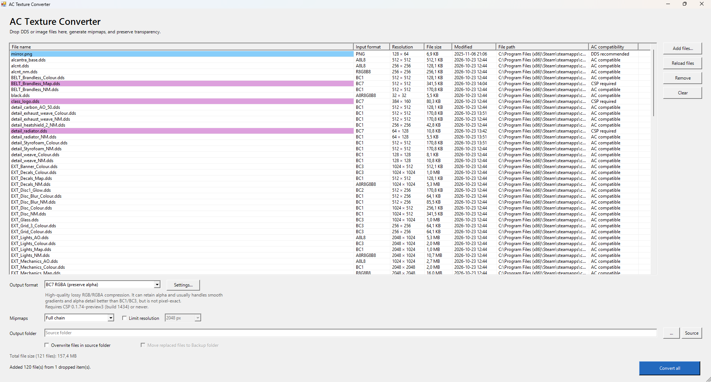
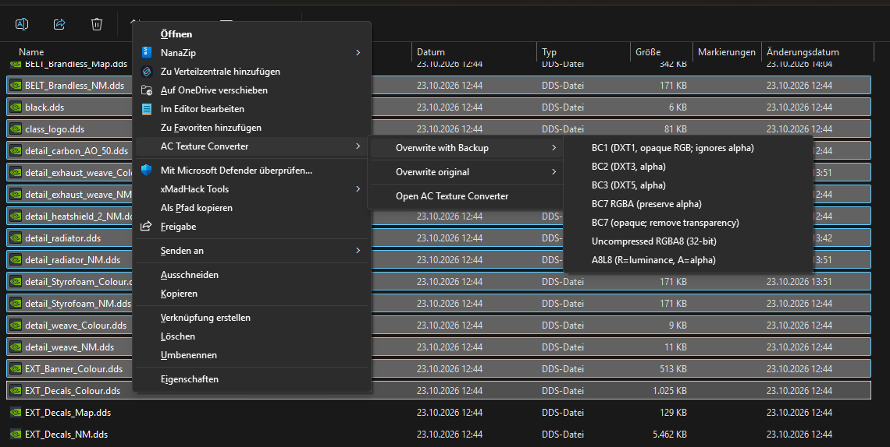

# AC Texture Converter v0.10.0

A Windows tool for converting DDS textures and common image files for Assetto Corsa modding workflows.

From File Explorer, convert selected DDS files directly with the AC Texture Converter submenu. Choose a format and overwrite action, or open the files in the full converter.

## Features and formats

- Convert individual files or batches from DDS, PNG, TGA, BMP, JPG/JPEG, TIF/TIFF, and HDR with the GUI, drag and drop, command line, or Explorer context menu. Explorer receives the full selected-file list in one operation.
- Review each file's input format, resolution, file size, modified date, and AC compatibility in the file list. Hover over a row for its full path and additional format and compatibility details.
- Sort the file list by clicking a column header. Click the same header again to reverse the sort order. Columns for file details size themselves to fit their contents; the file name and path columns use the available layout space.
- Convert only selected rows, or convert the full list when no rows are selected. The Convert button is disabled until at least one file is loaded.
- Choose an output format and view its description and compatibility notes below the format selector. Choose which formats appear in the selector in Settings.
- Generate a full mipmap chain, no mipmaps, or a limited number of levels. Optionally limit the output resolution; the image is scaled down while preserving its aspect ratio.
- Choose common AC formats: BC1 (opaque RGB), BC3, BC7 RGBA, opaque BC7, A8L8 (grayscale plus alpha), and uncompressed RGBA8. Enable additional formats in Settings: BC2, BC4, BC5, and BC6H.
- Save beside the source or to another folder. Existing files are protected by default; optional overwrite and backup controls are available.

BC7 DDS support is documented for Custom Shaders Patch (CSP) from version 0.1.74-preview3 (build 1434). Earlier CSP versions may not support it. A8L8 is a legacy luminance-plus-alpha DDS format; compatibility can depend on the Assetto Corsa and CSP versions and the texture loading path.

## Work with KN5 textures

Load or drop an unencrypted KN5 to extract its embedded textures into the conversion list. The app supports embedded DDS, PNG, JPG/JPEG, BMP, TGA, TIF/TIFF, and HDR images in KN5 versions 5 and 6. Convert textures with the same format, mipmap, and resolution controls, then choose **Pack KN5** to save a new KN5. You can remove textures before packing or add additional textures. Duplicate texture names are flagged because they can conflict. The source KN5 is never overwritten. Encrypted, malformed, and unsupported KN5 files are marked as not extractable.

## Install

1. Download [AC-Texture-Converter-Windows-v0.10.0.zip](https://github.com/GunnarFrei/AC-Texture-Converter/releases/download/v0.10.0/AC-Texture-Converter-Windows-v0.10.0.zip) and extract it.
2. Run `Install-ACTextureConverter.bat` and follow the prompts. The installer sets up the app and its per-user Explorer context menu for all supported input formats.
3. Right-click a supported texture file to open the AC Texture Converter menu. On Windows 11, it may be under **Show more options**. You can also start the app with `Open-ACTextureConverter.bat`.

To update an existing installation, run `Install-ACTextureConverter.bat` from the new package. It updates the installed app files and re-registers the Explorer menu to use that same installed copy.

To remove the app, run `Uninstall-ACTextureConverter.bat`.

## Licenses

AC Texture Converter is licensed under the MIT License. See [LICENSE](LICENSE).

The bundled Microsoft DirectXTex `texconv.exe` is also licensed under MIT. Its full notice is in [ThirdPartyNotices.txt](ThirdPartyNotices.txt).
