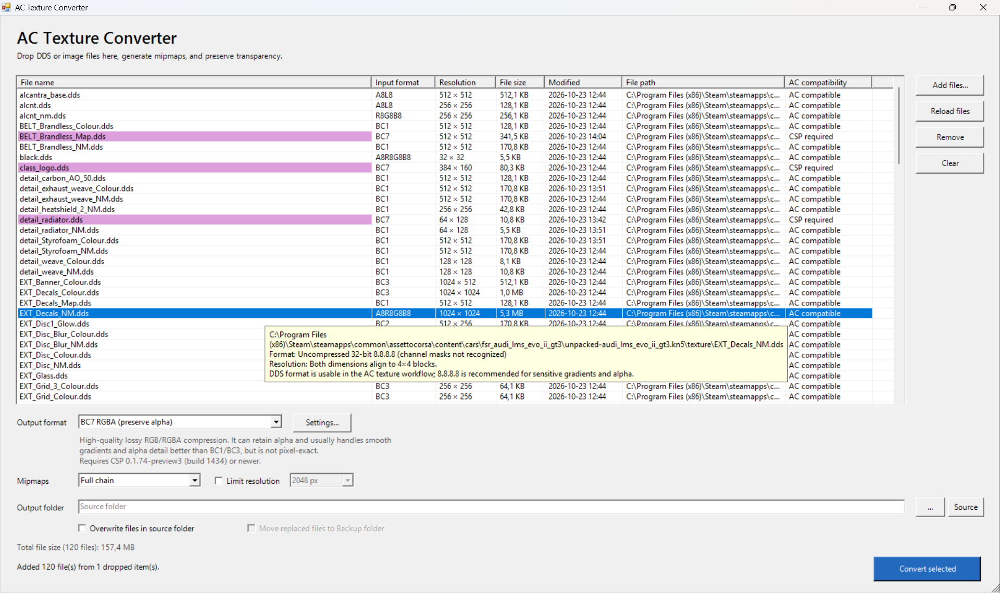

# AC Texture Converter v0.9.3

A Windows tool for converting DDS textures and common image files for Assetto Corsa modding workflows.

## Features and formats

- Convert individual files or batches from DDS, PNG, TGA, BMP, JPG/JPEG, TIF/TIFF, and HDR with the GUI, drag and drop, command line, or Explorer context menu. Explorer receives the full selected-file list in one operation.
- Generate mipmaps and choose how transparency is handled.
- Choose common AC formats: BC1 (opaque RGB), BC3, BC7 RGBA, opaque BC7, A8L8 (grayscale plus alpha), and uncompressed RGBA8.
- Enable additional formats in Settings: BC2, BC4, BC5, and BC6H.
- Save beside the source or to another folder. Existing files are protected by default; optional overwrite and backup controls are available.

BC7 DDS support is documented for Custom Shaders Patch (CSP) from version 0.1.74-preview3 (build 1434). Earlier CSP versions may not support it. A8L8 is a legacy luminance-plus-alpha DDS format; compatibility can depend on the Assetto Corsa and CSP versions and the texture loading path.

## Install

1. Download [AC-Texture-Converter-Windows-v0.9.3.zip](https://github.com/GunnarFrei/AC-Texture-Converter/releases/download/v0.9.3/AC-Texture-Converter-Windows-v0.9.3.zip) and extract it.
2. Run `Install-ACTextureConverter.bat` and follow the prompts. The installer sets up the app and its per-user Explorer context menu for all supported input formats.
3. Right-click a supported texture file to open the AC Texture Converter menu. On Windows 11, it may be under **Show more options**. You can also start the app with `Open-ACTextureConverter.bat`.

To remove the app, run `Uninstall-ACTextureConverter.bat`.

## Licenses

AC Texture Converter is licensed under the MIT License. See [LICENSE](LICENSE).

The bundled Microsoft DirectXTex `texconv.exe` is also licensed under MIT. Its full notice is in [ThirdPartyNotices.txt](ThirdPartyNotices.txt).
